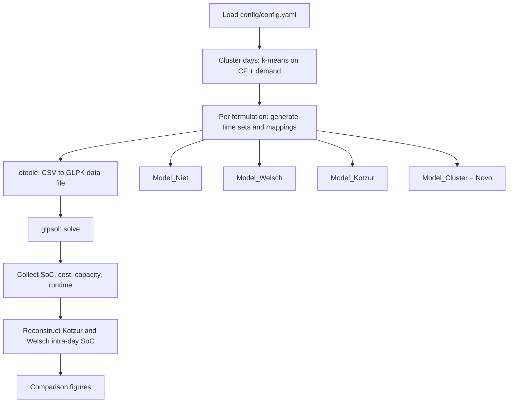

# Workflow Guide

`workflow/main.py` runs one scenario: it picks representative days, builds the inputs of each
storage formulation, solves them with GLPK and collects the results. All settings come from
`config/config.yaml` ({doc}`configuration_guide`).

```bash
python workflow/main.py        # from anywhere; or: make run-main
```

## Overview



## Steps

### 1. Representative days

`src.cluster_data()` reads the hourly capacity-factor and demand profiles (`data_8760.CF`,
`data_8760.SDP`), builds one 48-value vector per day (24 min–max scaled CF values and 24 demand
values) and runs k-means with `n_clusters` clusters (k-means++, `n_init = 1`, seed
`random_state`). The day closest to each cluster centre becomes the representative day. It returns
the representative days and, for each of the 365 days, the representative day that stands in for
it. Both are saved to `results/<scenario>_clustering.json`.

From `hour_grouping` = h: `b = 24 / h` blocks per day, `k · b` representative time slices and
`365 · b` chronological blocks.

### 2. Inputs of each formulation

For each formulation in `cases` (or in `models`, if given) the script:

1. clears the previous run's results of that formulation and copies the shared parameters from
   `data/system/` into `models/Model_<name>/inputs_csv/`;
2. copies the otoole template to `otoole_config_<name>.run.yaml`, where the run-specific values go;
3. writes the time sets and mappings the formulation needs:

| Formulation | Generated files | Functions |
|---|---|---|
| Novo (`Model_Cluster`) | `TIMESLICECRO`, `Conversionlts`, `DaySplit` | `new_list`, `conversionlts` |
| Kotzur | `DAYSCRO`, `Conversionld`, `Conversionldc`, `DaySplit` | `new_list`, `conversionld`, `conversionldc` |
| Welsch | `DAILYTIMEBRACKET`, `Conversionld`, `Conversionlh`, `Conversionls`, `DaysInDayType`, `DaySplit` | `new_list`, `conversionld`, `conversionlh`, `daysindaytype` |
| All four | `TIMESLICE`, `DAYTYPE`, `YearSplit`, `CapacityFactor`, `SpecifiedDemandProfile`, storage limits | `new_list`, `yearsplit`, `CFandSDP`, `new_yaml_param` |

`CFandSDP()` keeps the representative days of the hourly profiles and aggregates them into blocks
(mean for capacity factors, sum for demand). `yearsplit()` weights each time slice by the number of
days its representative day stands for.

### 3. Solve

otoole converts the CSVs to a GLPK data file (`models/Model_<name>/<name>.txt`) and
`src.run_simulation()` solves it with `glpsol`. If GLPK does not report an optimal solution, the
solve is retried with `--nopresol`, `--dual` and `--exact`; if all fail, the run is recorded as
`FAILED`.

### 4. Results

For each formulation, the native SoC series is copied to
`results/<scenario>_Storage_Level_Model_<name>.csv`, and `src.table()` appends one row (LP size,
total cost, run time, memory, new VRE and storage capacity, solver status) to
`results/Simulation_Results.xlsx`.

### 5. Post-processing

- Kotzur: `intraday_kotzur()` rebuilds the SoC at every chronological block by accumulating the
  net charge of the mapped representative block, starting from the year-start level
  (`..._Model_Kotzur_intraday.csv`).
- Welsch: `intraday_welsch2()` rebuilds the SoC in grouped day-type order
  (`..._Model_Welsch_intraday.csv`).
- When all four formulations ran, `graph()` writes three comparison figures:
  `<scenario>_Figure.png` (daily), `_Figure_Hourly.png` and `_Figure_Hourly_2Weeks.png`.

The output files are described in {doc}`outputs`.

## Runtime and memory

Median over all unconstrained runs of the study, almost all of them aggregated configurations
(archived results; GLPK 5.0, Intel Core i7, 16 GB):

| | Niet | Welsch | Kotzur | Novo |
|---|---|---|---|---|
| Model generation + solve | ~0.2 s | ~0.3 s | ~0.3 s | ~1 s |
| Memory | ~3 MB | ~6 MB | ~6 MB | ~43 MB |

Novo grows with the full chronological year: at k = 365, h = 1 it needs about 12 GB of memory and
several minutes per solve. The full-year benchmarks are therefore off by default in the
reproduction notebook.

## Troubleshooting

| Symptom | Check |
|---|---|
| `glpsol: command not found` | GLPK is installed in the environment: `conda run -n storage_osemosys glpsol --version` |
| `Solver status` is `FAILED` | The log in `results/logs/` (notebook and batch runs) or the console output shows GLPK's message |
| A formulation has no SoC file | It was not selected in `models`, or its solve failed |
| Figures missing | They are written only when all four formulations run |
